  <a href="https://itkannagara.dev">
    <picture>
      <source media="(prefers-color-scheme: dark)" srcset="./assets/banner-dark.svg" />
      <source media="(prefers-color-scheme: light)" srcset="./assets/banner-light.svg" />
      
    </picture>
  </a>

[`Portfolio`](https://itkannagara.dev)&nbsp;&nbsp;[`LinkedIn`](https://www.linkedin.com/in/it-kannangara)&nbsp;&nbsp;[`Email`](mailto:thenuka322@gmail.com)

## The short version

I am **Induwara Thenuka Kannangara**, a Software Engineering undergraduate and freelance developer from Sri Lanka. I build full-stack products, agentic AI systems, automations, and data-driven applications - from the first architecture sketch to a deployed experience people can actually use.

<b>Systems I have built</b>

 

- A hybrid online/offline event access-control system with C#/.NET, PostgreSQL, SQLite, and low-connectivity synchronization.
- An AI WhatsApp support and booking agent using n8n, structured knowledge, Google Sheets, and human handoff.
- A secured inventory desktop application with authentication, OTP verification, and PDF generation.
- An IEEE-CIS credit-card fraud detection pipeline covering preprocessing, feature engineering, model comparison, threshold tuning, and precision/recall/F1 evaluation.
- A Java and MySQL bakery ordering, sales, and inventory-management application.

## Technical toolkit

| Area | Working with |
|:--|:--|
| **Product & web engineering** | `TypeScript` `JavaScript` `React` `Next.js` `HTML` `CSS` `Tailwind CSS` `Node.js` `Java` `.NET` `Python` `FastAPI` `Flutter` |
| **Data, cloud & delivery** | `PostgreSQL` `MySQL` `MongoDB` `Redis` `Supabase` `Firebase` `Git` `GitHub` `Vercel` `Bash` |
| **AI, machine learning & automation** | `Gemini` `Ollama` `TensorFlow` `PyTorch` `scikit-learn` `Pandas` `NumPy` `n8n` `Blender` `Model Context Protocol` `ReAct agent loops` `Multi-agent systems` |

## Journey

| When | Chapter |
|:--|:--|
| **2024&nbsp;-&nbsp;present** | **Freelance Full-Stack Developer** - building and deploying responsive client products, APIs, authentication, databases, AI features, and business automations. |
| **2023&nbsp;-&nbsp;present** | **BSc (Hons) in Computing - Software Engineering**, Coventry University UK through NIBM Colombo. |
| **2022&nbsp;-&nbsp;2023** | **Diploma in Software Engineering**, NIBM Colombo - GPA **3.6 / 4.0**. |

<b>Certificates & continuous learning</b>

 

- **AMD AI Academy - AI Developer Course Series** - nine courses across LLMs, multi-agent systems, and AI infrastructure.
- **Meta Front-End Developer Professional Certificate** - Coursera.
- **Apache Airflow 3 Fundamentals** - Astronomer Academy.
- **AWS Cloud Technical Essentials** - Coursera.
- **Google UX Design Certificate** - Coursera.
- **AI/ML Engineer - Stage 1** - SLIIT.

## GitHub pulse

  <picture>
    <source media="(prefers-color-scheme: dark)" srcset="https://github-readme-stats.vercel.app/api?username=Thenuka22&show_icons=true&custom_title=GitHub%20stats&hide_border=true&bg_color=00000000&title_color=f9f9f6&text_color=a9a9a6&icon_color=ff633f&ring_color=ff633f" />
    <source media="(prefers-color-scheme: light)" srcset="https://github-readme-stats.vercel.app/api?username=Thenuka22&show_icons=true&custom_title=GitHub%20stats&hide_border=true&bg_color=00000000&title_color=171816&text_color=5c5d5a&icon_color=ff633f&ring_color=ff633f" />
    
  </picture>
  <picture>
    <source media="(prefers-color-scheme: dark)" srcset="https://streak-stats.demolab.com?user=Thenuka22&hide_border=true&background=00000000&ring=ff633f&fire=ff633f&currStreakLabel=f9f9f6&sideLabels=f9f9f6&currStreakNum=f9f9f6&sideNums=f9f9f6&dates=a9a9a6&stroke=3a3b39" />
    <source media="(prefers-color-scheme: light)" srcset="https://streak-stats.demolab.com?user=Thenuka22&hide_border=true&background=00000000&ring=ff633f&fire=ff633f&currStreakLabel=171816&sideLabels=171816&currStreakNum=171816&sideNums=171816&dates=5c5d5a&stroke=d9d9d6" />
    
  </picture>

<picture>
  <source media="(prefers-color-scheme: dark)" srcset="https://github-readme-activity-graph.vercel.app/graph?username=Thenuka22&bg_color=00000000&color=a9a9a6&line=f9f9f6&point=ff633f&area=false&hide_border=true&hide_title=true" />
  <source media="(prefers-color-scheme: light)" srcset="https://github-readme-activity-graph.vercel.app/graph?username=Thenuka22&bg_color=00000000&color=5c5d5a&line=171816&point=ff633f&area=false&hide_border=true&hide_title=true" />
  
</picture>

<picture>
  <source media="(prefers-color-scheme: dark)" srcset="https://raw.githubusercontent.com/Thenuka22/Thenuka22/output/github-contribution-grid-snake-dark.svg" />
  <source media="(prefers-color-scheme: light)" srcset="https://raw.githubusercontent.com/Thenuka22/Thenuka22/output/github-contribution-grid-snake.svg" />
  
</picture>

## Away from the keyboard

I have been part of the **Sumedha College Robotics Club**, and I am a former competitive badminton and cricket player across U13, U15, and U17 teams. Both shaped how I work today: stay curious, practice deliberately, and be useful to the team.

## Let us build something useful

I am open to freelance builds, AI collaborations, and software engineering opportunities. If the idea needs a thoughtful interface, a reliable backend, or an AI system that goes beyond a demo, I would love to hear about it.

[`Visit my portfolio`](https://itkannagara.dev)&nbsp;&nbsp;[`Connect on LinkedIn`](https://www.linkedin.com/in/it-kannangara)&nbsp;&nbsp;[`Email me`](mailto:thenuka322@gmail.com)

 

Designed with intention by Induwara Kannangara · Gampaha, Sri Lanka
